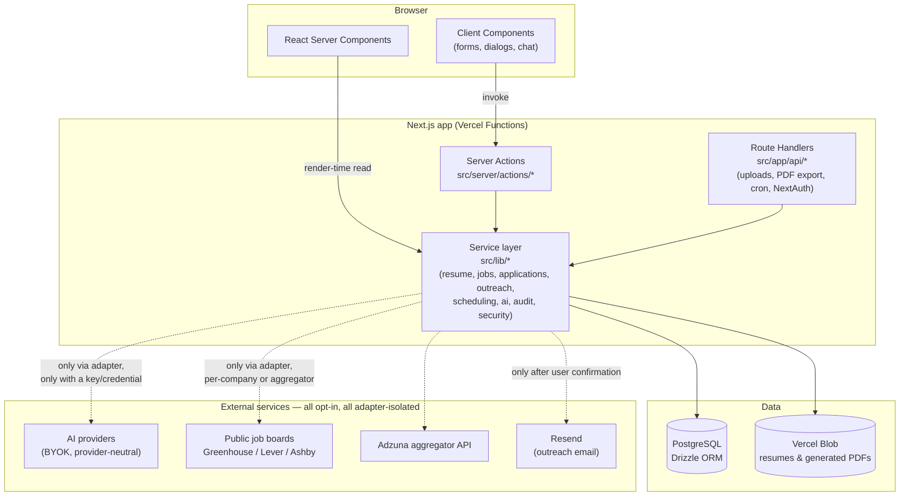
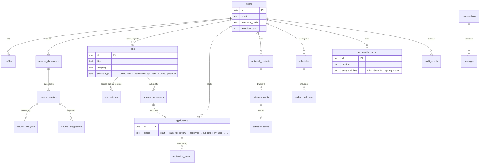
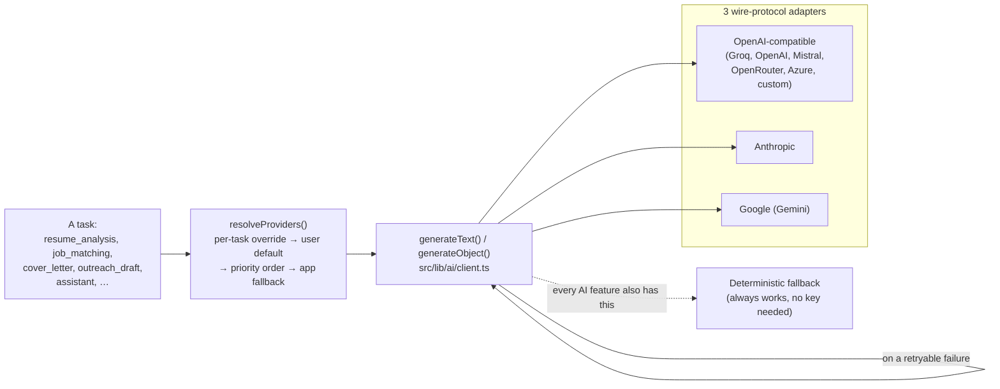
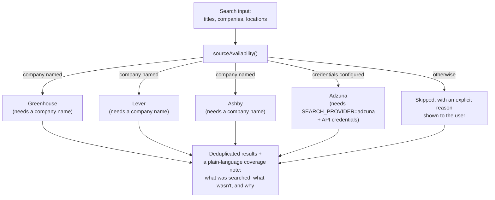
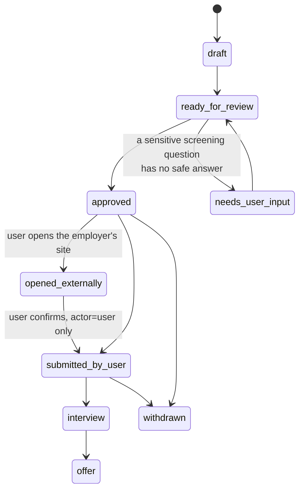
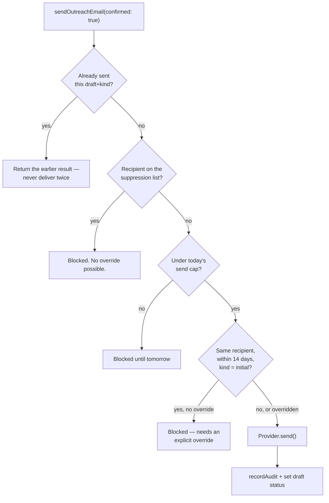

# Architecture

CareerPilot360 is a multi-tenant, human-in-the-loop AI job-application assistant. This document describes how it's built, why it's built that way, and where to look for what. It's written for contributors who don't yet have the codebase loaded in their head.

If you only read one section, read [Non-negotiable design rules](#non-negotiable-design-rules) — they constrain every other decision described below.

## Table of contents

- [Tech stack](#tech-stack)
- [Non-negotiable design rules](#non-negotiable-design-rules)
- [System overview](#system-overview)
- [Request lifecycle: resume upload](#request-lifecycle-resume-upload)
- [Data model](#data-model)
- [Module map](#module-map)
- [The AI provider abstraction](#the-ai-provider-abstraction)
- [Job discovery: the compliance boundary](#job-discovery-the-compliance-boundary)
- [Application state machine](#application-state-machine)
- [Outreach: the send pipeline](#outreach-the-send-pipeline)
- [Background work: scheduling and cron](#background-work-scheduling-and-cron)
- [The assistant](#the-assistant)
- [Testing strategy](#testing-strategy)
- [Deployment](#deployment)
- [Repository layout](#repository-layout)
- [Contributing](#contributing)

## Tech stack

| Layer | Choice | Why |
|---|---|---|
| Framework | [Next.js 16](https://nextjs.org) (App Router, Turbopack, React Server Components) | Server Actions give us a mutation layer with no separate REST/GraphQL API to maintain; RSC keeps secrets (DB credentials, provider keys) off the client by construction. |
| UI | React 19, Tailwind CSS 4, Radix UI primitives, `class-variance-authority` | Radix for accessible unstyled primitives (dialogs, menus, tabs); a small in-house component layer (`src/components/ui`) on top for the design system. |
| Language | TypeScript 5, strict mode | End-to-end type safety from DB row to JSX prop. |
| Database | PostgreSQL via [Drizzle ORM](https://orm.drizzle.team) | `postgres.js` in production, [PGlite](https://pglite.dev) (real Postgres compiled to WASM) for local dev and integration tests — same SQL, same schema, no Docker required. |
| Auth | [Auth.js v5](https://authjs.dev) | JWT sessions; email/password (bcrypt) + LinkedIn OpenID Connect sign-in only — no password/portal automation. |
| File storage | [Vercel Blob](https://vercel.com/docs/storage/vercel-blob) (prod), local filesystem (dev) | Private access; resumes and generated PDFs are streamed back only through authenticated routes. |
| AI | Provider-neutral abstraction over 8 providers (Groq, Google, OpenRouter, Mistral, OpenAI, Anthropic, Azure OpenAI, any OpenAI-compatible endpoint) | Users bring their own key (BYOK); an optional server-side fallback key keeps the product usable with zero setup. See [The AI provider abstraction](#the-ai-provider-abstraction). |
| PDF | [pdf-lib](https://pdf-lib.js.org) (generate), [unpdf](https://github.com/unjs/unpdf) (extract) | pdf-lib draws real, extractable text (no HTML-to-PDF screenshot pipeline); unpdf gives per-glyph coordinates for correct reading-order reconstruction. |
| DOCX | [mammoth](https://github.com/mwilliamson/mammoth.js) | Text extraction only — macros are never evaluated. |
| Email | [Resend](https://resend.com) (prod), console logger (dev/default) | Swappable behind one `EmailProvider` interface. |
| Validation | [Zod 4](https://zod.dev) | Every server action input, every AI structured-output schema. |
| Testing | [Vitest](https://vitest.dev) (unit/integration, real PGlite), [Playwright](https://playwright.dev) (e2e) + [axe-core](https://github.com/dequelabs/axe-core-npm) (automated a11y) | See [Testing strategy](#testing-strategy). |
| Deployment | [Vercel](https://vercel.com) only | Vercel Postgres/Marketplace Postgres, Vercel Blob, Vercel Cron. See [Deployment](#deployment). |

## Non-negotiable design rules

These aren't style preferences — they're the reason several things below look more conservative than they "need" to be.

1. **No scraping, no browser automation, ever.** LinkedIn, Naukri, Indeed and Glassdoor are never fetched, crawled, or automated. The only job sources are ones with a documented, permitted way in: public Greenhouse/Lever/Ashby boards, the Adzuna aggregator API, a single user-pasted URL, or manual entry. There is no crawler anywhere in this codebase.
2. **Nothing leaves the user's hands without an explicit click.** Marking an application "submitted," sending an outreach email, or opening a third-party apply page all require a real user action on a confirmation screen that shows the exact content first. No AI output, schedule, or background task can trigger any of these.
3. **Never fabricate a fact.** Every AI-written sentence is checked against the user's own resume/profile text before being shown; anything introducing a number, employer, or claim not already present is discarded and replaced with a deterministic template. See `findFabricatedMetrics` / `checkGrounding`.
4. **Deterministic first, AI second.** Every AI-assisted feature (resume scoring, job matching, drafting) has a fully working non-AI code path. AI can add prose explanation; it never changes a computed score.
5. **The ATS score is a heuristic.** It is labeled as one everywhere it appears. It is not, and does not claim to be, what any real employer's ATS will produce.
6. **Sensitive screening questions are never auto-answered.** Salary, work authorization, disability, gender, age, criminal history, relocation, notice period — these require the user's own stored answer and explicit reuse permission, or the field is left for the user to fill in.
7. **Strict tenant isolation.** Every read/write that touches user-owned data carries a `user_id` predicate. There is no cross-tenant query path.

## System overview



The service layer (`src/lib/*`) never talks to the browser directly and never trusts a client-supplied `userId` — every entry point (`server/actions/*`, `app/api/*`) resolves the caller from the session first and threads that verified id into every service call.

## Request lifecycle: resume upload

One concrete example of how a request moves through the layers above — chosen because it touches storage, parsing, a deterministic scorer, and the audit log in one round trip.

```mermaid
sequenceDiagram
    participant B as Browser
    participant R as Route handler<br/>(/api/resume/upload)
    participant Sec as security.ts
    participant Opt as optimize.ts
    participant Store as Vercel Blob
    participant Parse as parse.ts (unpdf/mammoth)
    participant Norm as normalize.ts
    participant Ats as ats.ts
    participant DB as Postgres

    B->>R: POST multipart (file, name)
    R->>R: requireUser() + rate limit
    R->>Sec: validateUpload(file, bytes)
    Sec-->>R: magic-byte + size + extension check (≤1MB)
    R->>Opt: optimizePdfBytes(bytes)
    Opt-->>R: lossless re-save via pdf-lib,<br/>or original bytes on any doubt
    R->>Store: put(optimizedBytes)
    R->>DB: insert resume_documents (status: pending)
    R->>Parse: extractText(originalBytes, kind)
    Parse-->>R: plain text + per-glyph reading order
    R->>Norm: normalizeResumeText(text)
    Norm-->>R: StructuredResume + warnings
    R->>Ats: analyzeResume(structured, profile)
    Ats-->>R: heuristic score + findings (never AI)
    R->>DB: insert resume_versions, resume_analyses
    R->>DB: recordAudit("resume.uploaded")
    R-->>B: { versionId, atsScore, warnings }
```

Parsing always runs on the **original** bytes, never the storage-optimized copy — the optimization step only changes what's written to Blob, never what's scored or shown.

## Data model

31 tables, grouped by the domain they serve. Full definitions in `src/lib/db/schema.ts`; migrations in `src/lib/db/migrations/`.



Two design choices worth calling out:

- **`resume_documents` vs `resume_versions`**: the original upload is immutable (content-wise — see the PDF storage note above); every AI/manual edit creates a new *version* with `parentVersionId` lineage, so "undo" is always "restore an earlier version," never a destructive overwrite.
- **`application_events`**: every status transition is appended here, never just overwritten on the `applications` row. This is what powers both the per-application timeline and the audit log.

## Module map

`src/lib/*` is where the actual behavior lives; everything above it (pages, server actions) is a thin, auth-checked adapter onto these modules.

| Module | Owns |
|---|---|
| `lib/security.ts` | Upload validation (magic bytes, size caps), SSRF-safe URL fetching, filename/HTML sanitization. Every byte of untrusted input passes through here first. |
| `lib/crypto.ts` | AES-256-GCM envelope encryption with key-ring rotation, used for AI provider keys. |
| `lib/db/` | Drizzle schema, migrations, the dual-driver client (`postgres.js` / PGlite), tenant-scoping helpers. |
| `lib/resume/` | `parse` → `normalize` → `ats` → `suggestions` → `pdf` → `optimize`, joined by `service.ts`. |
| `lib/jobs/` | Source adapters (`adapters/`), the compliance registry, dedupe, and the deterministic matching engine (`match.ts`, `match-service.ts`). |
| `lib/applications/` | The packet builder, the actor-gated state machine, screening-answer safety rules. |
| `lib/outreach/` | Contacts, drafts, and the send pipeline (idempotency, suppression list, rate limits, duplicate-recipient cooldown). |
| `lib/scheduling/` | Recurring schedules and the background-task queue the two cron routes drive. |
| `lib/ai/` | The provider-neutral client, the registry of providers/models, BYOK key management, and the assistant's tool allow-list. |
| `lib/assistant/` | Conversation storage and the tool-calling loop. |
| `lib/audit.ts` | The only writer to `audit_events`. Append-only, redacted. |
| `lib/history.ts` | The user-facing activity timeline (a curated subset of what `audit.ts` records in full). |

## The AI provider abstraction



A user's key is decrypted inside `resolveProviders()` and nowhere else — callers of `generateText`/`generateObject` never see a raw key, never pick a provider, and never see a raw provider error (they get a typed `AiError` they can branch on, or the deterministic fallback runs automatically).

Multi-turn tool calling (used by the assistant) round-trips through three genuinely different wire formats — OpenAI-style `tool_calls`, Anthropic's `tool_use`/`tool_result` content blocks, and Gemini's `functionCall`/`functionResponse` parts — which is why `ChatMessage` carries an explicit `toolCalls` field rather than leaving each adapter to reconstruct that transcript itself.

## Job discovery: the compliance boundary



There is a fourth, always-available path that bypasses this entirely: a user can paste a job URL directly (fetched once, through the SSRF-safe fetcher) or enter a job manually. **This is deliberately not an exhaustive internet-wide search** — the coverage note returned alongside every result says so explicitly, every time.

## Application state machine



`assertTransition()` enforces two things no caller can bypass: only `actor === 'user'` can reach `submitted_by_user`, and every transition — successful or attempted — is appended to `application_events`.

## Outreach: the send pipeline

Everything up to this point (drafting, editing, previewing) is inert. `sendOutreachEmail()` in `src/lib/outreach/send.ts` is the **only** function in the codebase that delivers an email, and only after `confirmed: true` — a value that can only come from a confirmation dialog that has already shown the exact recipient, subject, and body.



A LinkedIn message is drafted right alongside the email but is **never sent by this app** — it's copy-and-paste only, by design, since there is no permitted API for that.

## Background work: scheduling and cron

Two Vercel Cron routes drive everything: `enqueue-schedules` finds due user schedules and enqueues one row per firing (idempotent per schedule + due-instant), and `process-tasks` claims queued rows (`FOR UPDATE SKIP LOCKED`, so two overlapping invocations never double-process one) and runs them.

Every task type is **read-then-notify**: it re-scores saved jobs against the current resume, or checks for applications that have gone quiet, and writes a notification. None of them send anything or change tracked state — the same outward-facing-action rule from the top of this document applies here too.

> On Vercel's Hobby plan, cron jobs are capped at one run per day, so both routes currently run once daily rather than every few minutes — see `vercel.json`. Scheduling itself is UTC-only today; the `schedules.timezone` column exists but per-user timezone conversion isn't implemented yet.

## The assistant

The `/assistant` chat is read-only by design in this version: every tool in `src/lib/ai/tools.ts` looks up real data (dashboard stats, matches, applications, outreach drafts) and returns it — none of them mutate anything. The `messages` table has `pendingConfirmation`/`confirmedAt` columns reserved for a future mutating-tool-with-confirmation flow (matching the outreach send pattern above); don't add a mutating tool without building that flow first.

## Testing strategy

| Layer | Tool | What it actually exercises |
|---|---|---|
| Unit / integration | Vitest + real PGlite (WASM Postgres, not mocks) | Full service-layer round trips — cascades, unique constraints, `ON CONFLICT`, row locking — against real SQL. |
| End-to-end | Playwright, against a real running dev server | Signup → onboarding → dashboard, every nav-linked page renders, feature flows (outreach contact creation, suppression list). |
| Accessibility | `@axe-core/playwright`, WCAG 2 A/AA tags | Automated scan on the pages a new user actually sees. Caught and fixed real contrast and missing-accessible-name issues during development — see `e2e/accessibility.spec.ts`. |

Run everything with:

```bash
npm run verify        # typecheck + unit/integration tests
npm run test:e2e       # playwright (starts its own dev server unless E2E_NO_SERVER=1)
```

## Deployment

Vercel-only, deliberately — see the top-level [README.md](README.md) for the full step-by-step guide (Supabase/Neon/Prisma Postgres setup, Vercel Blob, environment variables, and the cron caveat above). In short:

1. Provision Postgres from the Vercel Marketplace and Vercel Blob for storage.
2. Set `AUTH_SECRET`, `ENCRYPTION_KEY`, `CRON_SECRET`, `NEXT_PUBLIC_APP_URL`.
3. Deploy, then run `npm run db:migrate` and `npm run db:seed` against the production `DATABASE_URL` once (not automatic on deploy).

## Repository layout

```
src/
  app/                    Routes (App Router) — (marketing), (auth), (app), api/
  components/
    ui/                   Design-system primitives (Button, Card, Dialog, …)
    <domain>/              Feature UI (resume/, jobs/, outreach/, schedule/, assistant/, …)
  lib/                     Everything in the module map above — the actual application logic
  server/actions/          'use server' entry points — thin, auth-checked wrappers over lib/*
tests/                     Vitest unit/integration specs + fixtures + a real-PGlite test harness
e2e/                       Playwright specs (auth, navigation, accessibility, feature flows)
scripts/                   migrate.ts, seed.ts, load-env.ts
graphify-out/              A local, code-only knowledge graph of this repo (see below)
```

This repo also carries a [graphify](https://github.com/Graphify-Labs/graphify) knowledge graph in `graphify-out/` — a local tree-sitter AST graph with no LLM involved and nothing leaving your machine. If you have it installed, `graphify explain "<symbol>"` and `graphify query "<question>"` are usually faster than grepping when you're getting oriented; regenerate after changing code with `graphify . --code-only && graphify cluster-only .`.

## Contributing

See [CONTRIBUTING.md](CONTRIBUTING.md) for local setup, coding conventions, and the PR process. See [SECURITY.md](SECURITY.md) to report a vulnerability privately rather than through a public issue. All contributors are expected to follow the [Code of Conduct](CODE_OF_CONDUCT.md).

Before opening a PR, `npm run verify` (typecheck + tests) must pass, and please read the [non-negotiable design rules](#non-negotiable-design-rules) above — a PR that adds scraping, auto-submission, or a fabricated-content path will be closed regardless of how well it's implemented.
